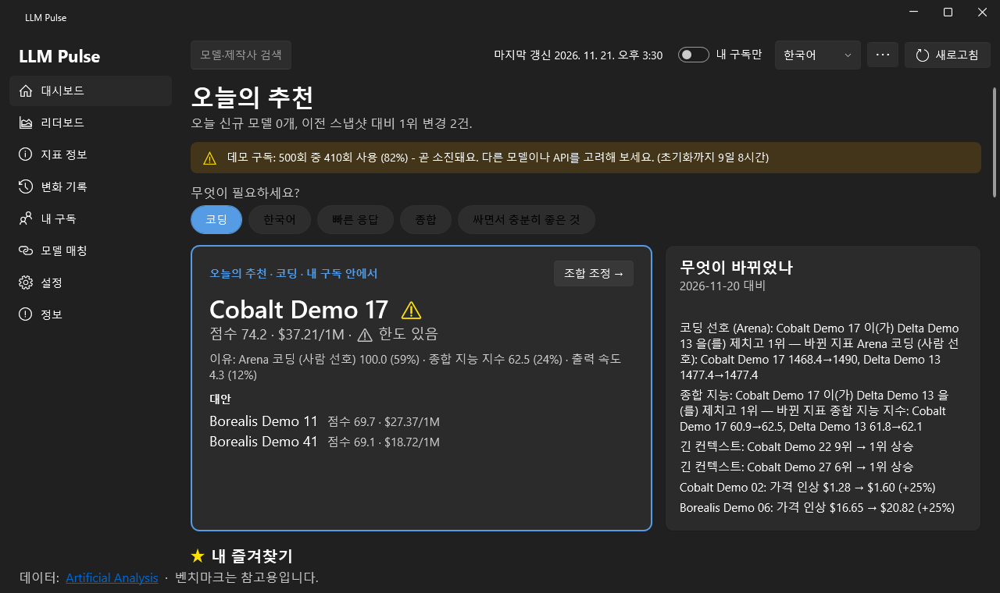
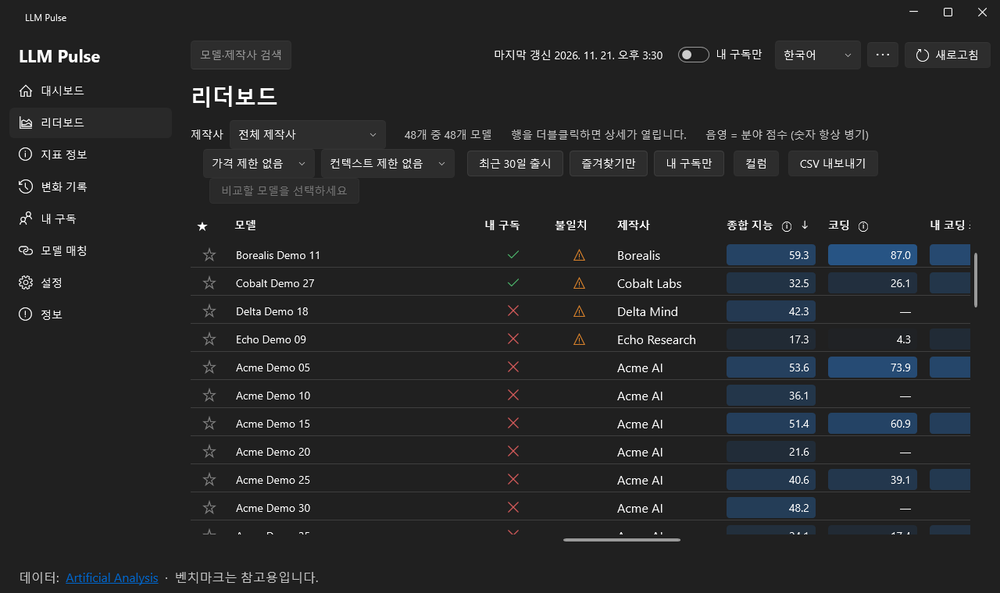
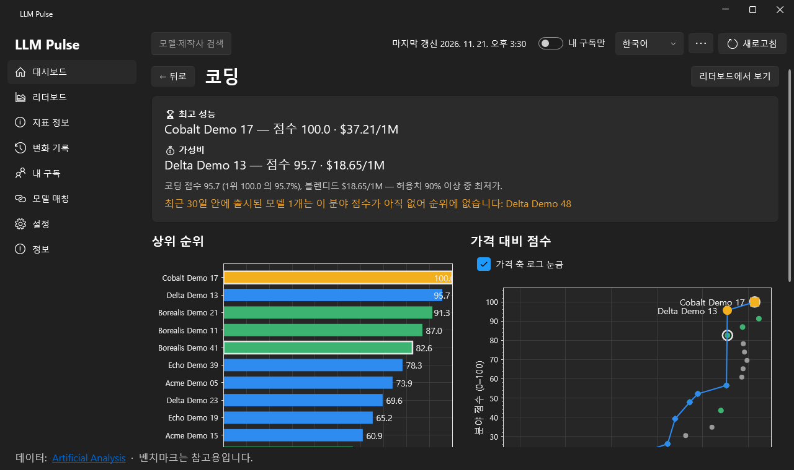
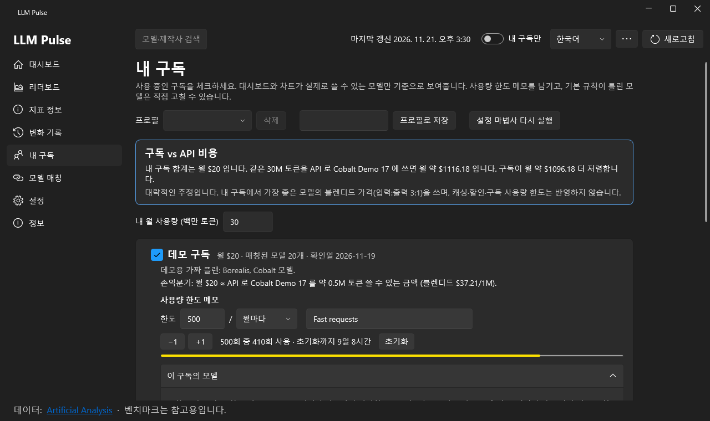
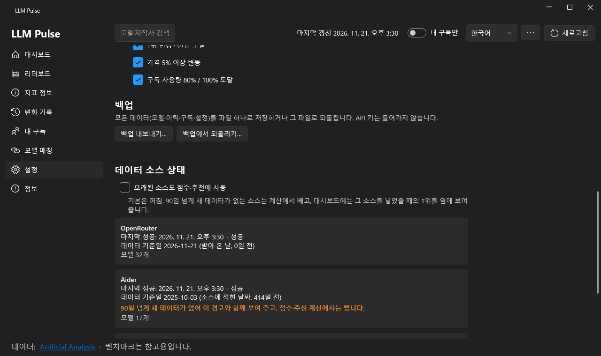

# LLM Pulse

LLM 벤치마크와 가격을 매일 모아 "오늘 내 구독 안에서 어떤 모델을 쓰면 좋은지"를 알려 주는 Windows 트레이 앱입니다.

- **버전** 1.0.0 · **만든 사람** 배민혁 · **라이선스** MIT
- **스택** C# / .NET 8 · WPF · WPF-UI · CommunityToolkit.Mvvm · SQLite(Dapper) · ScottPlot 5 · Velopack
- **화면 언어** English / 한국어 / 中文 / Français



> 화면의 모델 이름·점수는 모두 `--demo` 가짜 데이터입니다.

## 1. 어떤 관점에서 만들었나

반도체 검사 장비 SW 를 만들면서 익힌 방식을 벤치마크에 그대로 씁니다. **벤치마크 숫자를 검사 데이터처럼 다룹니다.**

- 숫자마다 출처 · 척도 · 산정 방식 · 측정 날짜를 붙입니다.
- 두 측정원(소스)이 같은 모델을 다르게 말하면 값을 하나 고르지 않고 "어긋남"을 표시합니다.
- 오래된 측정값은 경고하고 판정(추천)에서 뺍니다. 뺐을 때와 넣었을 때의 결과를 나란히 보여 줍니다.
- 결과가 바뀌면 무엇 때문에 바뀌었는지 이력으로 남깁니다.

## 2. 무엇을 해결하나

여러 공개 소스(Artificial Analysis, OpenRouter, Arena, Aider)를 모델 이름 매칭으로 합쳐, **내가 결제한 구독 안에서** 분야별 최고 · 가성비 모델을 매일 추천합니다. 구독 사용 한도 · 초기화 · 가격 변동은 트레이 알림으로 알려 줍니다.

| 화면 | 하는 일 |
| --- | --- |
| 대시보드 | 분야별 1위 · 가성비 · 내 구독 안 1위, 1위가 바뀐 이유, 오래된 소스 안내 |
| 리더보드 | 정렬 · 필터 · 즐겨찾기 · CSV, **소스 불일치(⚠) 열** |
| 분야 상세 | 지표별 기여도, 가중치 조절 · 프리셋, 가격-점수 산점도(파레토) |
| 모델 비교 | 레이더 · 추이 · 월 예상 비용 |
| 내 구독 | 쓰는 구독 선택, 한도 메모 · +1/−1 · 초기화 카운트다운, 구독 대 API 손익분기 |
| 변화 기록 | 두 날짜 스냅샷 비교(순위 · 가격), 출시 타임라인 |
| 설정 | 소스별 데이터 기준일 · 오래됨 경고, 백업 내보내기 · 가져오기, 자동 업데이트 |

| 리더보드 (불일치 열) | 분야 상세 |
| --- | --- |
|  |  |

| 내 구독 | 설정 (소스 신선도) |
| --- | --- |
|  |  |

## 3. 상용 제품과 무엇이 다른가 (조사일 2026-11-21)

| 제품 | 무엇을 하나 | 내 구독으로 거르기 |
| --- | --- | --- |
| [Artificial Analysis](https://artificialanalysis.ai/) | 지능 · 속도 · 가격 벤치마크 웹과 무료 API ([문서](https://artificialanalysis.ai/api-reference)) | 없음 |
| [Arena](https://arena.ai/leaderboard) | 사람 투표(Elo) 순위. 2026-01-28 LMArena 에서 이름 변경 ([공지](https://arena.ai/blog/lmarena-is-now-arena/)) | 없음 |
| [OpenRouter Rankings](https://openrouter.ai/rankings) | 품질이 아닌 토큰 사용량 순위 | 없음 |
| [llm-stats](https://llm-stats.com/), [Vellum](https://www.vellum.ai/llm-leaderboard) | 공개 순위 웹 | 없음 |
| [Aider 리더보드](https://aider.chat/docs/leaderboards/) | 코딩 폴리글랏 통과율. 데이터 파일의 마지막 항목이 2025-10-03 | 없음 |
| [Win-CodexBar](https://github.com/Finesssee/Win-CodexBar), [tokenwatcher](https://github.com/gehariharan/tokenwatcher) | Windows 트레이에서 구독 사용량 · 한도 추적 | 해당 없음 (벤치마크 없음) |

조사한 제품 중에서 찾지 못한 것 (2026-11 기준):

1. **내가 결제한 구독 안에서만 추천**하고, 구독과 API 종량제의 손익분기를 보여 준다.
2. **여러 소스를 합친 뒤** 날짜 스냅샷 비교, **소스 간 불일치 경고**, **소스별 데이터 기준일 · 오래됨 처리**를 한다.
   - 불일치: AA 가격과 OpenRouter 가격이 2배 이상 다름, AA 지능 지수 백분위와 Arena 백분위가 40점 이상 다름
   - 오래됨: 소스 데이터에 적힌 날짜가 90일을 넘으면 경고하고 점수 계산에서 뺀다. 넣었다면 1위가 누구였는지(Shadow)는 옆에 보여 준다
   - 1위가 바뀌면 이유를 붙인다: 새 모델 · 이전 1위 데이터 빠짐 · 계산 기준 변경 · 어떤 지표가 얼마에서 얼마로 바뀌었는지
3. 벤치마크 추천과 구독 사용 한도를 **하나의 Windows 트레이 앱**에서 본다.

2026-11-21 공개 데이터(모델 763개)로 확인한 값: Aider 데이터 기준일 2025-10-03(414일 전, 오래됨 → 제외), 가격 비교 가능 135쌍 중 2배 이상 차이 17쌍, 지능-Arena 백분위 비교 가능 38개 중 40점 이상 차이 5개.

## 4. 설치와 사용

### 설치 (권장)

[Releases](https://github.com/mhbae-semi-lab/llm-pulse/releases) 에서 `LLMPulse.App-win-Setup.exe` 를 받아 실행합니다. 관리자 권한이 필요 없고 `%LOCALAPPDATA%\LLMPulse.App` 에 설치되며 시작 메뉴 바로가기를 만듭니다.

- **코드 서명이 없어** Windows SmartScreen 이 "Windows의 PC 보호" 창을 띄웁니다. **추가 정보 → 실행** 을 누르세요.
- **자동 업데이트**: 설치판은 실행 1분 뒤 새 버전을 조용히 받아 두고 다음 실행 때 적용합니다. 설정에서 끌 수 있고, 정보 화면에서 바로 설치할 수도 있습니다.
- **제거**: Windows 설정 → 앱 → LLM Pulse → 제거. 자동 실행 · 예약 작업도 함께 지웁니다. 내 데이터(`%LOCALAPPDATA%\LLMPulse`)는 남으니 필요 없으면 직접 지우세요.

설치 없이 쓰려면 `LLMPulse-<버전>-win-x64.zip`(자체 포함) 또는 `-lite.zip`(.NET 8 Desktop Runtime 필요)을 풀어 실행합니다. 함께 든 `install.ps1` 로 시작 메뉴에 등록 · 제거할 수 있습니다(`-Uninstall`, 데이터까지 지우려면 `-RemoveData`).

### 처음 실행

1. 첫 실행 마법사에서 [Artificial Analysis 무료 API 키](https://artificialanalysis.ai/api-reference)를 넣습니다(무료, 24시간 창마다 100회, 출처 표기 조건). 키가 없어도 OpenRouter · Arena · Aider 는 받지만 모델 목록의 기준이 AA 라서 대부분 화면이 비어 있습니다.
2. 쓰는 구독을 체크합니다. 대시보드 · 리더보드가 실제로 쓸 수 있는 모델 기준으로 바뀝니다.
3. 매일 자동 갱신(작업 스케줄러, 기본 08:00) 또는 로그인 시 트레이로 시작을 켭니다.

사용자 매뉴얼: [PPTX](docs/manual/LLM-Pulse-User-Manual-ko.pptx) · [PDF](docs/manual/LLM-Pulse-User-Manual-ko.pdf) (한국어).

### 데이터 소스

| 소스 | 역할 | 키 | 기준일 |
| --- | --- | --- | --- |
| [Artificial Analysis](https://artificialanalysis.ai/) | 주 소스(지능 · 속도 · 가격) | 필요 | 받아 온 날 |
| [OpenRouter](https://openrouter.ai/) | 가격 · 컨텍스트 보강, 가격 불일치 비교 | 불필요 | 받아 온 날 |
| [Arena](https://arena.ai/leaderboard) | 사람 선호 Elo (HuggingFace `lmarena-ai/leaderboard-dataset`) | 불필요 | 리더보드 게시일 |
| [Aider](https://aider.chat/docs/leaderboards/) | 코딩 폴리글랏 통과율 | 불필요 | 데이터 항목의 최신 날짜 |

구독 플랜 목록(`data/plans.json`)은 갱신 때 이 저장소에서 내려받아 다음 실행부터 씁니다. 받지 못하거나 형식이 틀리면 이전 사본이나 내장본을 씁니다. 직접 고치려면 데이터 폴더에 `plans.user.json` 을 두세요.

### 개인정보 · 보안

- 모든 데이터는 이 PC(`%LOCALAPPDATA%\LLMPulse`)에만 저장됩니다. 사용 기록 · 개인 정보는 어디에도 보내지 않습니다.
- 네트워크 접근: 공개 벤치마크 데이터, 이 저장소의 `plans.json`, GitHub Releases 업데이트 확인(설치판 자동, 끌 수 있음).
- AA API 키는 설정 파일 · 로그 · 백업에 쓰지 않고 DPAPI(현재 Windows 사용자)로 암호화해 `secrets\` 에 둡니다.
- 구독 사용량은 브라우저 쿠키 · 세션을 쓰지 않습니다. Claude Code 는 켰을 때만 로컬 로그(`~/.claude/projects`)를 읽기 전용으로 셉니다.
- 처리되지 않은 예외는 `%LOCALAPPDATA%\LLMPulse\crash.log` 에만 기록됩니다.

### 빌드

요구 사항: .NET 8 SDK 이상, Windows 10/11.

```powershell
dotnet build src/LLMPulse.App -c Debug
dotnet test  src/LLMPulse.Tests -c Debug
```

배포 패키지 (Velopack CLI 필요: `dotnet tool install -g vpk --version 1.2.161`):

```powershell
.\scripts\publish.ps1          # publish/velopack/ (Setup.exe, nupkg) + publish/LLMPulse-<버전>-win-x64.zip
.\scripts\publish.ps1 -Lite    # publish/LLMPulse-<버전>-win-x64-lite.zip
```

`v1.0.0` 같은 태그를 푸시하면 [release 워크플로](.github/workflows/release.yml)가 테스트 뒤 패키지를 만들어 **초안(draft) 릴리스**로 올립니다. 공개는 GitHub 에서 직접 합니다. 일반 푸시와 PR 은 [CI](.github/workflows/ci.yml)가 빌드 · 테스트합니다.

업데이트를 로컬에서 시험하려면 두 버전을 같은 폴더에 만들고 `LLMPULSE_UPDATE_FEED` 를 그 폴더로 지정해 설치판을 실행합니다.

```powershell
.\scripts\publish.ps1 -Version 1.0.0 -OutDir D:\feed100
.\scripts\publish.ps1 -Version 1.0.1 -OutDir D:\feed
$env:LLMPULSE_UPDATE_FEED = "D:\feed"
```

### 명령줄 옵션

| 옵션 | 설명 |
| --- | --- |
| `--demo` | 가짜 데이터, 임시 폴더(`%TEMP%\llmpulse-demo`)에서 실행 |
| `--screenshot <dir>` | 모든 화면을 4개 언어로 PNG 저장 후 종료 |
| `--refresh` / `--set-api-key` | 창 없이 갱신 / 키 저장 (`$env:AA_API_KEY` 사용) |
| `--force` | AA 응답 캐시 무시 (캐시: 예약 · 명령줄 6시간, 수동 새로고침 1시간) |
| `--background` | 창 없이 트레이로 시작 (자동 실행용) |

환경 변수: `LLMPULSE_DATA_DIR`(데이터 폴더), `LLMPULSE_UPDATE_FEED`(업데이트 피드), `LLMPULSE_PLANS_URL`(플랜 목록 주소).

### 구조

```
src/
  LLMPulse.Core/   도메인 · 점수 · 소스 어댑터 · 신선도 · 불일치 · SQLite (UI 의존 없음)
  LLMPulse.App/    WPF 앱 (MVVM, 로컬라이제이션, 차트, 트레이, Velopack)
  LLMPulse.Tests/  xUnit 테스트
data/              지표 · 분야 · 구독 플랜 카탈로그(JSON)
docs/              설계 문서, 스크린샷, 사용자 매뉴얼
scripts/           publish.ps1(패키징), install.ps1(휴대용 zip 설치/제거)
```

## 5. 한계

- 코드 서명이 없어 SmartScreen 경고가 뜹니다.
- AA 무료 API 는 코딩 · 에이전트 지수를 모든 모델에서 비워 내려 줍니다(2026-11-20 확인). "코딩"은 Arena 코딩 + Aider 로 계산하고, "에이전트" 분야는 뺐습니다.
- Aider 리더보드는 2025-10-03 이후 새 항목이 없어 기본 설정에서 점수 계산에 쓰지 않습니다(설정에서 다시 켤 수 있음).
- "장비 SW" 프리셋은 C# 전용 공개 지표가 없어 Arena 코딩(일반) · Aider 폴리글랏(C++ 포함) · Arena 한국어 · 컨텍스트 길이로 근사합니다.
- 가격 불일치는 제공사별 가격 차이가 큰 오픈 웨이트 모델에서 자주 나옵니다. 경고는 "확인해 보라"는 뜻이지 어느 쪽이 틀렸다는 뜻이 아닙니다.
- Arena · Aider 는 최신 모델의 점수가 늦게 들어옵니다. Cursor · ChatGPT 구독은 로컬 사용량 로그가 없어 수동 +1 · 단축키로만 셉니다.
- 벤치마크는 참고용입니다. 오염 · 자체 보고 가능성이 있습니다.

## 6. 만든 방식

AI 보조 개발: 코드 · 문서의 상당 부분을 Claude Code(Anthropic)로 작성했습니다. 요구사항 · 설계 결정 · 검증(테스트, 실제 공개 데이터 점검, 설치 · 업데이트 확인)은 작성자가 했습니다.

## 라이선스와 데이터 출처

코드는 [MIT](LICENSE) 입니다. 표시되는 벤치마크 · 가격 데이터의 권리는 각 출처(Artificial Analysis, OpenRouter, Arena, Aider)에 있으며, Artificial Analysis 데이터는 출처 표기 조건으로 사용합니다(앱 하단에 항상 표시).

배민혁 · © 2026
